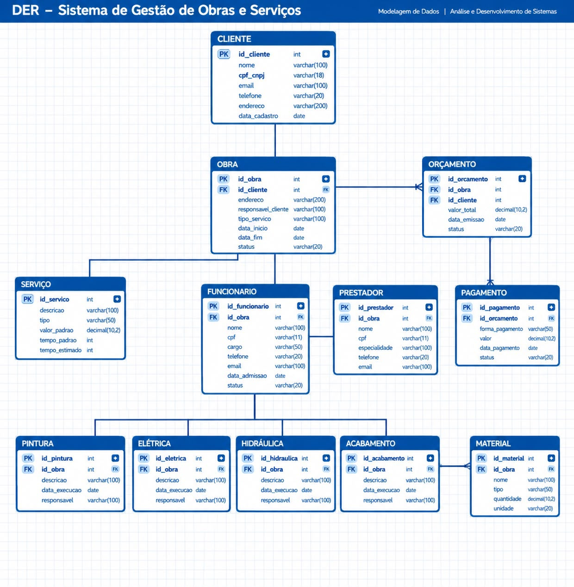

# Entrega 2 — Relatorio Tecnico Final 
### Modelagem de um sistema de gestão de informações para uma organização de pequeno porte

Grupo; Clara Victoria Soares Cardoso RGM: 47015225,
Kalebe Leonardo Cutrim Freitas RGM: 47211431,
Cauê Soares Gomes Alves RGM: 47207094,
Arthur Marques Silva RGM: 4711793-1,
---

# Modelagem de Banco de Dados para a JG Construções

## Introdução

A JG Construções LTDA é uma empresa de pequeno/médio porte do ramo da construção civil que atualmente não possui nenhum sistema informatizado de gestão: informações de clientes, obras, orçamentos, serviços prestados e pagamentos ficam espalhadas entre planilhas, anotações em papel e conversas informais. Esse cenário dificulta o controle do andamento das obras, a consulta rápida de dados e a geração de relatórios gerenciais.

Objetivo desse trabalho é criar um sistema centralizado para armazenar, organizar, consultar e proteger as informações da empresa, facilitando o gerenciamento das obras e dos serviços prestados.

A delimitação desta primeira entrega é o **núcleo do ciclo orçamento → obra**: cadastro de cliente, orçamento de serviços, execução da obra com equipe alocada, compra de material junto a fornecedores e controle de pagamento por etapa.

## Desenvolvimento

### Caracterização da Organização

- **Nome e natureza da organização:** JG Construções — empresa privada com fins lucrativos, do ramo de reformas e construção civil de pequeno porte.
- **Contexto e porte:** *empresa registrada como ME (microempresa) junto à Receita Federal, mas que opera atualmente com cerca de 20 ou mais pessoas envolvidas entre equipe efetiva e prestadores/subcontratados nas obras.
- **Problemas e necessidades identificados:** antes do sistema proposto, orçamentos, obras, alocação de equipe e compra de material eram controlados de forma manual/dispersa, sem um cadastro único de clientes nem histórico organizado de qual funcionário trabalhou em qual obra, ou quanto foi gasto em material por obra.
- **Justificativa da escolha:**  A empresa foi escolhida por apresentar uma necessidade de melhorar a organização de informações sobre clientes, serviços e orçamentos. O desenvolvimento de um sistema pode facilitar essas atividades, tornando o trabalho mais rápido e organizado.
- **Evidências da organização:** Nome e natureza da organização: JG Construções LTDA
 (nome fantasia: JG Construções), Sociedade Empresária Limitada, com fins lucrativos.
CNPJ: 63.489.213/0001-49 (Matriz)
Situação cadastral: Ativa (desde 03/11/2025)
Endereço: R. Alberta Hunter, 761, Vila Brasil, São Paulo – SP, CEP 08.210-681
Contato: (11) 8161-3422 · jovaldo.santos@hotmail.com

### Diagrama Modelo Conceitual (DER)

Ao revisar o DER, foram encontradas inconsistências entre o desenho dos relacionamentos, as chaves estrangeiras declaradas e as regras de negócio (RF01–RF10). Os ajustes realizados foram:
 
| # | Problema no DER original | Ajuste | Justificativa |
|---|---|---|---|
| 1 | `OBRA.tipo_servico` é texto livre; uma obra pode ter vários serviços (pintura e elétrica). O DER também liga Obra a Serviço ("é de") sem FK em nenhuma das tabelas. | Criada a entidade associativa `OBRA_SERVICO` (N:N). Removido `tipo_servico` de `OBRA`. | Atende RF03/RF04 (associar serviços às obras) e evita atributo multivalorado (1FN). |
| 2 | `SERVICO.tempo_estimado` depende da obra, não do serviço (o serviço já tem `tempo_padrao`). | `tempo_estimado` movido para `OBRA_SERVICO`; adicionado `tempo_real`. | Elimina dependência parcial (2FN) e permite medir desvio de prazo. |
| 3 | `PINTURA`, `ELÉTRICA`, `HIDRÁULICA` e `ACABAMENTO` têm estrutura idêntica (`descricao`, `data_execucao`, `responsavel`). | Consolidadas em `OBRA_SERVICO`; o tipo é dado por `SERVICO.tipo`. | Evita 4 tabelas duplicadas; um novo tipo de serviço (ex.: manutenção, citada em RF03) vira apenas uma linha em `SERVICO`, sem nova tabela. |
| 4 | `FUNCIONARIO.id_obra` e `PRESTADOR.id_obra` prendem a pessoa a uma única obra. | Criadas `ALOCACAO_FUNCIONARIO` e `ALOCACAO_PRESTADOR` (N:N). | Na prática, um profissional atua em várias obras ao longo do tempo. |
| 5 | `responsavel` (texto) nas tabelas de serviço. | Vira FK para `FUNCIONARIO` ou `PRESTADOR` em `OBRA_SERVICO`. | Integridade referencial e rastreabilidade (RF05, RF08). |
| 6 | O relacionamento "elabora" ligava Funcionário a Prestador (1:1), sem respaldo nos requisitos. | Reinterpretado como *Funcionário elabora Orçamento* (1:N), com FK em `ORCAMENTO`. | Atende RF06 (elaboração de orçamentos) e dá respaldo ao relacionamento nos requisitos. |
| 7 | `ORCAMENTO.id_cliente` é redundante: orçamento → obra → cliente. | Removido; o cliente é obtido via `OBRA`. | Elimina dependência transitiva (3FN) e risco de inconsistência. |
| 8 | `PAGAMENTO` ligado a `SERVIÇO` no desenho, mas com FK para `ORCAMENTO` na tabela. | Mantida apenas a relação Orçamento 1:N Pagamento. | Pagamentos quitam orçamentos (RF07). |
| 9 | `MATERIAL` tinha `id_obra` (um material em uma obra só) e o desenho o ligava a Orçamento/Hidráulica. | `MATERIAL` vira catálogo; `OBRA_MATERIAL` (N:N) registra quantidade por obra e, opcionalmente, o serviço que o utilizou. Adicionado `custo_unitario`. | O mesmo material é usado em várias obras (2FN); habilita análise de custo. |
---

## Conversão do Modelo Conceitual para o Modelo Lógico
 
####  Entidades → Tabelas
 
| Entidade (DER) | Tabela (lógico) | Observação |
|---|---|---|
| CLIENTE | `cliente` | Conversão direta. |
| OBRA | `obra` | Conversão direta (sem `tipo_servico`). |
| SERVIÇO | `servico` | Catálogo de serviços. |
| FUNCIONÁRIO | `funcionario` | Sem `id_obra`. |
| PRESTADOR | `prestador` | Sem `id_obra`. |
| ORÇAMENTO | `orcamento` | Sem `id_cliente`; ganha `id_funcionario`. |
| PAGAMENTO | `pagamento` | Conversão direta. |
| MATERIAL | `material` | Vira catálogo. |
| PINTURA, ELÉTRICA, HIDRÁULICA, ACABAMENTO | `obra_servico` | Uma só tabela; o tipo vem de `servico.tipo`. |
| *(novas, de relacionamentos N:N)* | `alocacao_funcionario`, `alocacao_prestador`, `obra_material` | Tabelas associativas novas. |
 
**Total: 12 tabelas.**
 
####  Atributos → Colunas
 
Cada atributo virou uma coluna com tipo SQL mantido do DER (`int`, `varchar(n)`, `decimal(10,2)`, `date`). Alterações:
 
- Chaves `id_*` passam a ser `INT` autoincrementais (identity).
- `servico.tempo_padrao` e `obra_servico.tempo_estimado`/`tempo_real` são em **horas**.
- `responsavel` (varchar) foi substituído por colunas FK.
- Atributos de data e status ganharam `DEFAULT` e `CHECK` (ver [1.5](#15-justificativas-técnicas-das-decisões)).
- Novas colunas: `obra_servico.tempo_real`, `obra_servico.valor_contratado`, `material.custo_unitario`, `orcamento.id_funcionario`.
####  Relacionamentos → Chaves e  Cardinalidades
 
| Relacionamento | Cardinalidade | Como foi traduzido |
|---|---|---|
| Cliente possui Obra | 1:N | FK `obra.id_cliente → cliente`. |
| Obra tem Serviço (é de) | N:N | Tabela associativa `obra_servico` com FKs para `obra` e `servico`. |
| Obra possui Funcionário | N:N | Associativa `alocacao_funcionario` (PK composta `id_obra` + `id_funcionario` + `data_inicio`). |
| Obra possui Prestador | N:N | Associativa `alocacao_prestador` (PK composta `id_obra` + `id_prestador` + `data_inicio`). |
| Obra tem Orçamento | 1:N | FK `orcamento.id_obra → obra`. |
| Funcionário elabora Orçamento | 1:N | FK `orcamento.id_funcionario → funcionario`. |
| Orçamento possui Pagamento | 1:N | FK `pagamento.id_orcamento → orcamento`. |
| Funcionário / Prestador realiza Serviço da obra | 1:N (cada) | FKs opcionais `obra_servico.id_funcionario` e `obra_servico.id_prestador`. |
| Obra utiliza Material | N:N | Associativa `obra_material` (com quantidade). |
| Serviço da obra utiliza Material | 1:N (opcional) | FK nula `obra_material.id_obra_servico`. |
 
> Não há relacionamentos 1:1 no modelo final. Os **4 relacionamentos N:N** do DER (obra–serviço, obra–funcionário, obra–prestador e obra–material) viraram tabelas associativas; os atributos do relacionamento (quantidade, datas, tempos) ficaram nelas.

---
## Chaves Primárias e Estrangeiras
 
| Tabela | Chave primária | Chaves estrangeiras |
|---|---|---|
| `cliente` | `id_cliente` | — |
| `obra` | `id_obra` | `id_cliente → cliente` |
| `servico` | `id_servico` | — |
| `obra_servico` | `id_obra_servico` | `id_obra → obra`; `id_servico → servico`; `id_funcionario → funcionario` (nula); `id_prestador → prestador` (nula) |
| `funcionario` | `id_funcionario` | — |
| `prestador` | `id_prestador` | — |
| `alocacao_funcionario` | (`id_obra`, `id_funcionario`, `data_inicio`) | `id_obra → obra`; `id_funcionario → funcionario` |
| `alocacao_prestador` | (`id_obra`, `id_prestador`, `data_inicio`) | `id_obra → obra`; `id_prestador → prestador` |
| `orcamento` | `id_orcamento` | `id_obra → obra`; `id_funcionario → funcionario` |
| `pagamento` | `id_pagamento` | `id_orcamento → orcamento` |
| `material` | `id_material` | — |
| `obra_material` | `id_obra_material` | `id_obra → obra`; `id_material → material`; `id_obra_servico → obra_servico` (nula) |
 
---

## Processo de Normalização
 
#### 1FN — atributos atômicos e sem grupos repetitivos
 
- **Problema:** `OBRA.tipo_servico` armazenava o tipo do serviço em texto; uma obra com pintura e elétrica exigiria "Pintura, Elétrica" na mesma célula (valor multivalorado) ou linhas duplicadas.
- **Solução:** o vínculo obra–serviço foi para `obra_servico`, uma linha por serviço.
- **Demais atributos:** `telefone`, `email`, `cpf_cnpj` guardam um único valor. `endereco` foi mantido como texto único por decisão de escopo (não há consulta por rua/cidade nos requisitos); se RF08/RF09 passarem a filtrar por cidade, deve ser decomposto.
- **Por que foi necessária:** sem ela, RF03/RF04 e a consulta por serviço (RF08) seriam inconsistentes.
#### 2FN — sem dependência parcial da chave
 
Só importa onde há chave composta ou conceito N:N:
 
- `tempo_estimado` estava em `SERVICO`, mas varia por obra → dependia de (obra, serviço). Movido para `obra_servico`.
- `quantidade` de material dependia de (obra, material), não do material sozinho. Colocada em `obra_material`.
- `data_execucao`, `valor_contratado` e `tempo_real` dependem do serviço naquela obra → `obra_servico`.
- Em `alocacao_*`, os atributos (`data_fim`, `funcao`) dependem da chave composta inteira.
- **Por que foi necessária:** evitar que o mesmo serviço/material tivesse um único tempo/quantidade global, o que tornaria impossível orçar obras diferentes.
#### 3FN — sem dependência transitiva
 
- `ORCAMENTO.id_cliente`: `id_orcamento → id_obra → id_cliente`. Removido; o cliente é obtido por JOIN.
- `OBRA.tipo_servico`: determinado por `id_servico → tipo`. Removido (ver 1FN).
- Atributos do serviço (`descricao`, `tipo`, `valor_padrao`) ficam só em `servico`; `obra_servico` guarda apenas o `id_servico`.
- Dados de funcionário/prestador (nome, cargo, especialidade) ficam só nas suas tabelas; `obra_servico` guarda o id.
- `orcamento.valor_total` e `pagamento.valor` não são recalculados de outras tabelas: são valores acordados/transacionados em uma data (um "retrato" financeiro), portanto não configuram dependência transitiva.
- **Por que foi necessária:** reduzir risco de anomalias de atualização (ex.: trocar o cliente da obra e esquecer o orçamento).
---

## Justificativas Técnicas das Decisões
 
#### Chaves primárias
 
- **Chaves substitutas inteiras (`id_*`)** nas entidades principais: CPF/CNPJ e e-mail podem mudar ou ser corrigidos; um identificador numérico é estável, compacto e eficiente em JOINs. CPF/CNPJ continua protegido por `UNIQUE`.
- **PK composta em `alocacao_funcionario` e `alocacao_prestador`:** a identidade da alocação é o trio (obra, pessoa, `data_inicio`). Incluir `data_inicio` impede duplicidade da mesma alocação, mas permite que um profissional seja realocado à mesma obra em outro período, o que o par (obra, pessoa) sozinho não permitiria.
- **`id_obra_servico` e `id_obra_material` substitutos:** a mesma combinação pode se repetir legitimamente (ex.: duas demãos de pintura), e `obra_material` precisa ser referenciada opcionalmente por `id_obra_servico`.
#### Chaves estrangeiras e relacionamentos
 
| FK | Relacionamento implementado | Política de exclusão |
|---|---|---|
| `obra.id_cliente` | Cliente 1:N Obra | `RESTRICT` — não apagar cliente com obras (histórico). |
| `orcamento.id_obra` | Obra 1:N Orçamento | `RESTRICT` |
| `orcamento.id_funcionario` | Funcionário elabora Orçamento | `RESTRICT` |
| `pagamento.id_orcamento` | Orçamento 1:N Pagamento | `RESTRICT` — registros financeiros não somem. |
| `obra_servico.*` | Obra N:N Serviço; execução por funcionário/prestador | `RESTRICT` em `servico`, `funcionario`, `prestador`; `CASCADE` em `obra`. |
| `alocacao_*`, `obra_material` | N:N | `CASCADE` ao remover a obra (dados dependentes); `RESTRICT` para pessoa/material. |
 
Em geral: dados financeiros e históricos usam `RESTRICT` (atende RF01 — exclusão controlada — e RF09 — relatórios); só dados puramente dependentes de uma obra usam `CASCADE`.
 
#### Restrições aplicadas
 
**Unicidade (`UNIQUE`):** `cliente.cpf_cnpj`, `cliente.email`, `funcionario.cpf`, `funcionario.email`, `prestador.cpf` e `servico.descricao`. A tabela `obra_servico` não tem restrição de unicidade, por design.
 
**Obrigatoriedade (`NOT NULL`):** nomes, documentos, FKs obrigatórias, datas de início/emissão, status, valores.
**Opcionais:** `obra.data_fim`, `obra_servico.tempo_real`, e-mail do prestador.
 
**Valores permitidos (`CHECK`):**
 
- `obra.status ∈ {Planejada, Em andamento, Pausada, Concluída, Cancelada}`
- `orcamento.status ∈ {Pendente, Aprovado, Rejeitado, Expirado}`
- `pagamento.status ∈ {Pendente, Pago, Atrasado, Estornado}`
- `pagamento.forma_pagamento ∈ {PIX, Boleto, Cartão, Dinheiro, Transferência}`
- `servico.tipo ∈ {Pintura, Elétrica, Hidráulica, Acabamento, Manutenção}`
- Valores monetários `>= 0` (`pagamento.valor > 0`); tempos e quantidades `> 0`
- `obra.data_fim >= data_inicio`
- `obra_servico`: ao menos um executor (`id_funcionario` ou `id_prestador`) informado.
**Padrões (`DEFAULT`):** `data_cadastro = CURRENT_DATE`, status iniciais.
 
#### Decisões arquiteturais gerais
 
1. **3FN como alvo** (premissa do DER): equilíbrio entre integridade e simplicidade de consultas.
2. **Generalização em vez de 4 tabelas por especialidade:** reduz duplicação e dá extensibilidade.
3. **Catálogo × instância** (`servico`/`material` × `obra_servico`/`obra_material`): padroniza preços e permite comparar o previsto com o realizado.
4. **Histórico preservado:** `RESTRICT` e status em vez de exclusão física.
5. **LGPD:** dados pessoais (CPF, e-mail, telefone) concentrados em `cliente`, `funcionario` e `prestador`, facilitando controle de acesso por perfil, mascaramento e anonimização.
6. **Preparado para crescimento:** novos tipos de serviço, formas de pagamento e status exigem só inserção/ajuste de `CHECK`, sem mudar a estrutura.
---

 ## Proposta de Arquitetura Analítica para BI e IA
 
#### Informações estratégicas extraíveis
 
- Quais tipos de serviço geram mais receita e margem.
- Onde há atrasos: por tipo de serviço, equipe, prestador ou cliente.
- Gargalos de capacidade (profissionais sobrealocados ou ociosos).
- Comportamento de pagamento e risco de inadimplência.
- Consumo e custo de materiais por obra/serviço.
- Qualidade das estimativas (previsto × realizado).
- Perfil e recorrência de clientes.
#### KPIs propostos
 
| KPI | Fórmula (base) |
|---|---|
| Obras em andamento / concluídas / atrasadas | `COUNT(obra)` por `status` e `data_fim` vs. data atual |
| Prazo médio de execução | `AVG(data_fim − data_inicio)` |
| Desvio de prazo por serviço | `(tempo_real − tempo_estimado) / tempo_estimado` em `obra_servico` |
| Receita por tipo de serviço | `SUM(valor_contratado)` agrupado por `servico.tipo` |
| Ticket médio por orçamento aprovado | `AVG(orcamento.valor_total)` dos orçamentos com status `Aprovado` (se uma obra tiver vários, agregar por `id_obra` antes da média para obter o ticket por obra) |
| Taxa de aprovação de orçamentos | aprovados ÷ emitidos |
| Taxa de inadimplência | `SUM(valor)` com status `Atrasado` ÷ total a receber |
| Prazo médio de recebimento | `AVG(pagamento.data_pagamento − orcamento.data_emissao)`, com junção de `pagamento` a `orcamento` |
| Custo de materiais / margem bruta sobre materiais | `SUM(quantidade × custo_unitario)`; `valor_contratado − custo_materiais` (não inclui mão de obra) |
| Taxa de ocupação da equipe | obras/serviços ativos por funcionário e prestador |
| Retenção de clientes | clientes com 2+ obras ÷ total de clientes |
 
#### Potencial para BI
 
O modelo normalizado alimenta, via ETL, um **esquema estrela**:
 
- **Fatos:**
  - `fato_execucao_servico` (origem `obra_servico`: valor, tempo estimado/real, desvio)
  - `fato_pagamento` (origem `pagamento`)
  - `fato_consumo_material` (origem `obra_material`)
- **Dimensões:** `dim_cliente`, `dim_obra`, `dim_servico`, `dim_profissional` (funcionário/prestador), `dim_material`, `dim_tempo`.
**Painéis sugeridos:**
 
1. **Visão executiva:** receita, margem, obras ativas, inadimplência.
2. **Operação:** cronograma, atrasos, alocação da equipe.
3. **Financeiro:** orçado × contratado × recebido, aging de recebíveis.
4. **Suprimentos:** consumo e custo de materiais.
5. **Comercial:** funil de orçamentos e ticket médio.
Isso responde diretamente RF08 (consultas), RF09 (relatórios) e RF10 (acompanhamento).
 
#### Aplicações analíticas e de IA
 
| Aplicação | Descrição |
|---|---|
| Previsão de prazo e custo (regressão) | Usa tipo de serviço, tempo padrão, histórico de desvios e equipe para prever duração e custo de novas obras. |
| Apoio à precificação | Sugerir `valor_contratado` com base em obras similares. |
| Risco de inadimplência (classificação) | Prevê atraso de pagamento por forma de pagamento, valor e histórico do cliente. |
| Recomendação de serviços (cross-sell) | Regras de associação (ex.: clientes que contratam pintura frequentemente contratam acabamento). |
| Alocação inteligente | Recomendar profissional por especialidade, disponibilidade e desempenho. |
| Previsão de demanda de materiais | Séries temporais para antecipar compras. |
| Detecção de anomalias | Quantidades de material ou custos fora do padrão. |
 
> **Requisito de dados:** o modelo já armazena o realizado (`tempo_real`, `data_fim`, `data_pagamento`), necessário para treinar os modelos acima. Recomenda-se que o sistema exija o registro desses campos ao concluir cada obra/serviço. Dados pessoais devem ser anonimizados nas bases analíticas (LGPD).
 
---
 
## 2. Modelo Lógico Relacional
 
O modelo lógico completo (tabelas, colunas, PKs, FKs, restrições, cardinalidades e script SQL) está no documento separado [`modelo_logico_relacional.md`](./modelo_logico_relacional.md), disponível neste repositório.

#### Requisitos Funcionais

RF01 – Cadastrar clientes

O sistema deve permitir o cadastro, consulta, alteração e exclusão dos dados dos clientes.

Especificações:

* Cadastrar nome completo ou razão social;
* CPF ou CNPJ;
* Telefone;
* E-mail;
* Endereço;
* Data de cadastro;
* Observações;
* Permitir consultar clientes cadastrados;
* Permitir alterar dados existentes;
* Permitir excluir ou inativar um cadastro;
* O sistema deve verificar se CPF/CNPJ já está cadastrado;
* Campos obrigatórios não poderão ser deixados em branco.

Usuário responsável: administrador ou funcionário autorizado.

⸻

RF02 – Cadastrar obras

O sistema deve permitir registrar e gerenciar as obras contratadas pela empresa.

Especificações:

* Número ou código da obra;
* Nome ou identificação da obra;
* Cliente responsável;
* Endereço da obra;
* Tipo de serviço;
* Data de início prevista;
* Data de término prevista;
* Data de término efetiva;
* Descrição da obra;
* Valor estimado;
* Responsável pela obra;
* Status da obra.

Status possíveis:

* Planejada;
* Em andamento;
* Pausada;
* Concluída;
* Cancelada.

O sistema deve permitir consultar, alterar e atualizar as informações da obra.

Usuário responsável: administrador, gestor ou funcionário autorizado.

⸻

RF03 – Cadastrar serviços

O sistema deve permitir cadastrar e gerenciar os serviços oferecidos pela empresa.

Exemplos:

* Pintura;
* Instalação elétrica;
* Serviços hidráulicos;
* Acabamento;
* Manutenção;
* Reforma;
* Instalação de pisos;
* Outros serviços de construção.

Especificações:

* Código do serviço;
* Nome;
* Descrição;
* Categoria;
* Valor estimado ou preço-base;
* Unidade de medida, quando aplicável;
* Status: ativo ou inativo.

O sistema deve permitir alterar ou inativar serviços que não sejam mais oferecidos.

⸻

RF04 – Associar serviços às obras

O sistema deve permitir relacionar um ou mais serviços a uma determinada obra.

Especificações:

* Identificar a obra;
* Identificar o cliente;
* Selecionar o serviço;
* Informar profissional responsável;
* Informar quantidade;
* Informar valor do serviço;
* Registrar data de início;
* Registrar data de conclusão;
* Informar status do serviço;
* Adicionar observações.

Uma obra poderá possuir vários serviços, e cada serviço poderá estar relacionado a diferentes obras.

⸻

RF05 – Cadastrar funcionários e prestadores

O sistema deve permitir cadastrar os profissionais envolvidos na execução dos serviços.

Especificações:

* Nome completo;
* CPF;
* Telefone;
* E-mail;
* Endereço;
* Cargo ou função;
* Tipo de vínculo;
* Especialidade;
* Data de cadastro;
* Status do profissional.

O sistema deve diferenciar funcionários contratados pela empresa de prestadores de serviços terceirizados.

⸻

RF06 – Registrar orçamento

O sistema deve permitir criar, consultar e gerenciar orçamentos solicitados pelos clientes.

Especificações:

* Número do orçamento;
* Cliente;
* Data de emissão;
* Prazo de validade;
* Serviços solicitados;
* Quantidade;
* Valores individuais;
* Descontos, quando aplicável;
* Valor total;
* Forma de pagamento;
* Prazo estimado para execução;
* Observações;
* Responsável pelo orçamento.

Status possíveis:

* Em elaboração;
* Enviado;
* Aprovado;
* Recusado;
* Expirado;
* Cancelado.

O sistema deve calcular automaticamente o valor total do orçamento com base nos serviços cadastrados.

⸻

RF07 – Registrar pagamentos

O sistema deve permitir registrar os pagamentos relacionados às obras e aos serviços contratados.

Especificações:

* Cliente;
* Obra;
* Orçamento ou serviço relacionado;
* Data do pagamento;
* Valor pago;
* Forma de pagamento;
* Número ou identificação da parcela;
* Status do pagamento;
* Observações.

Formas de pagamento:

* Dinheiro;
* PIX;
* Cartão;
* Transferência bancária;
* Boleto;
* Outras formas cadastradas.

O sistema deve permitir consultar os pagamentos realizados e identificar valores pendentes.

⸻

RF08 – Consultar informações

O sistema deve permitir pesquisar e consultar os dados armazenados no banco de dados.

A pesquisa deverá permitir filtros por:

* Cliente;
* Obra;
* Serviço;
* Funcionário;
* Prestador;
* Orçamento;
* Pagamento;
* Status;
* Período.

O sistema deve apresentar os resultados de forma organizada e permitir acessar os detalhes do registro selecionado.

⸻

RF09 – Gerar relatórios

O sistema deve permitir gerar relatórios para auxiliar no controle administrativo e operacional da empresa.

Relatórios previstos:

* Relatório de clientes cadastrados;
* Relatório de obras;
* Obras em andamento;
* Obras concluídas;
* Serviços realizados;
* Serviços por obra;
* Funcionários e prestadores;
* Orçamentos aprovados e recusados;
* Pagamentos realizados;
* Pagamentos pendentes;
* Valores recebidos por período.

Os relatórios devem permitir filtros por período, cliente, obra e status, quando aplicável.

⸻

RF10 – Controlar o andamento das obras

O sistema deve permitir acompanhar o andamento de cada obra.

Especificações:

* Registrar o status atual da obra;
* Atualizar o status conforme o andamento;
* Registrar data da alteração;
* Identificar o responsável pela alteração;
* Permitir visualizar o histórico de status;
* Associar serviços e profissionais à obra;
* Informar observações sobre o andamento.

Status:

1. Planejada;
2. Em andamento;
3. Pausada;
4. Concluída;
5. Cancelada.

#### Requisitos Não Funcionais

RNF01 – Segurança

O sistema deve garantir a proteção dos dados armazenados e restringir o acesso às informações de acordo com o nível de autorização de cada usuário.

Especificações:

* Login e senha para acesso;
* Senhas armazenadas de forma segura;
* Controle de permissões;
* Bloqueio de acesso a usuários não autorizados;
* Encerramento de sessão após período de inatividade;
* Registro das principais ações realizadas pelos usuários.

⸻

RNF02 – Desempenho

O sistema deve apresentar bom desempenho durante as operações de cadastro, consulta, alteração e geração de relatórios.

Especificações:

* Consultas comuns devem apresentar resultados rapidamente;
* O banco de dados deve possuir estrutura adequada para grandes quantidades de registros;
* Índices devem ser utilizados quando necessários;
* O sistema não deve apresentar lentidão significativa com o crescimento da base de dados.

⸻

RNF03 – Usabilidade

A interface deve ser simples, intuitiva e fácil de utilizar.

Especificações:

* Menus organizados por categoria;
* Botões e campos identificados claramente;
* Formulários padronizados;
* Mensagens de erro compreensíveis;
* Confirmação antes de operações importantes, como exclusão;
* Layout organizado;
* Navegação simples;
* Adaptação para diferentes tamanhos de tela, quando aplicável.

⸻

RNF04 – Disponibilidade

O sistema deve estar disponível durante o horário de funcionamento da empresa.

Especificações:

* O sistema deve permanecer acessível durante o período de trabalho;
* Manutenções programadas devem ser realizadas preferencialmente fora do horário de funcionamento;
* Em caso de falha, o sistema deverá permitir recuperação dos dados por meio do backup;
* Erros críticos devem ser registrados para análise.

⸻

RNF05 – Integridade dos dados

O sistema deve garantir que os dados armazenados sejam corretos, completos e consistentes.

Especificações:

* Impedir cadastro duplicado de CPF/CNPJ;
* Validar campos obrigatórios;
* Validar formatos de e-mail e telefone;
* Utilizar chaves primárias e estrangeiras no banco de dados;
* Impedir a criação de relacionamentos inexistentes;
* Evitar valores inválidos;
* Manter a consistência entre clientes, obras, serviços e pagamentos.

Exemplo: não deve ser possível associar uma obra a um cliente que não esteja cadastrado.

⸻

RNF06 – Backup

O sistema deve realizar cópias de segurança periódicas dos dados armazenados.

Especificações:

* Realizar backups automaticamente;
* Definir periodicidade para as cópias;
* Armazenar backups em local seguro;
* Manter mais de uma cópia quando possível;
* Permitir recuperação dos dados em caso de falha;
* Restringir o acesso aos arquivos de backup.

⸻

RNF07 – Escalabilidade

O sistema deve permitir o crescimento da quantidade de informações sem comprometer significativamente seu funcionamento.

Especificações:

* Suportar aumento no número de clientes;
* Suportar aumento no número de obras;
* Suportar aumento no número de serviços;
* Suportar aumento no número de funcionários e prestadores;
* Permitir expansão futura das funcionalidades;
* Utilizar estrutura de banco de dados preparada para crescimento.

⸻

RNF08 – Privacidade

O sistema deve proteger os dados pessoais dos clientes, funcionários e prestadores, seguindo os princípios estabelecidos pela Lei Geral de Proteção de Dados (LGPD).

Especificações:

* Coletar somente os dados necessários para as finalidades do sistema;
* Restringir o acesso a informações pessoais;
* Permitir acesso aos dados conforme autorização;
* Proteger os dados contra acesso não autorizado;
* Evitar exposição desnecessária de informações pessoais;
* Manter registros e procedimentos adequados para tratamento dos dados;
* Permitir a exclusão ou correção de dados quando aplicável e conforme as regras legais.
---

### Regras de Negócio

- **Regras operacionais:**
  - Uma obra só pode ser aberta a partir de um orçamento aprovado pelo cliente (status do orçamento precisa refletir essa aprovação).
  - Um pagamento é sempre vinculado a uma obra específica e a uma etapa (número da etapa) — não existe pagamento solto, sem obra.
  - Uma compra de material é sempre vinculada a um fornecedor, mas o vínculo com a obra é opcional — pode haver compra para reposição do estoque geral, sem uma obra específica de destino (ver dicionário de dados, entidade Compra).
  - Um funcionário só pode ser alocado a uma obra dentro do período em que seu vínculo com a empresa está ativo.
- **Restrições organizacionais:**
  - Fornecedor precisa ter CNPJ único cadastrado — evita duplicidade de cadastro do mesmo fornecedor.
  - Cliente precisa ter CPF/CNPJ único — mesma lógica, evita cliente duplicado.
  - Serviços têm valor de referência no catálogo, mas o valor efetivamente cobrado no orçamento pode ser diferente (negociação) — por isso o valor mora no item do orçamento, não só no catálogo.

---

### Dicionário de Dados
*(vale 10% — Dimensão Procedimental)*

O dicionário de dados não é reproduzido aqui para manter este documento legível.
Ele está versionado no repositório, em dois arquivos:

- **[`dicionario.html`](dicionario.html)** — dicionário navegável, alinhado ao DER.
- **[`dicionario-conceitual.md`](dicionario-conceitual.md)** — dicionário conceitual em notação de Chen, com Fornecedor e Compra.

*Exemplos são genéricos/ilustrativos — não há dado real de cliente, funcionário ou fornecedor.*

---

### Justificativa Técnica

A decisão central do modelo foi **separar o que foi orçado (relacionamento Orçamento-Serviço) do que foi de fato executado (Obra_Serviço)**, em vez de assumir que a obra sempre executa exatamente o que constava no orçamento. Na prática de uma obra, quantidade e escopo de um serviço podem mudar no meio do caminho (mais metros quadrados do que o previsto, um serviço cancelado). Um único registro que misturasse "orçado" e "executado" perderia essa diferença — e é justamente essa diferença que a empresa precisa para saber se está ganhando ou perdendo dinheiro numa obra em relação ao que foi vendido ao cliente.

A segunda decisão foi **tratar Serviço e Material como catálogos**, com valor de referência próprio, independente do que é negociado em cada orçamento/compra. Isso evita redigitar "Pintura interna — R$ 35/m²" a cada novo orçamento, mas também permite que o valor efetivamente cobrado (atributo do relacionamento Orçamento-Serviço) seja diferente do valor de referência do catálogo — refletindo a regra de negócio real de que todo orçamento é, até certo ponto, negociado com o cliente. Quantidade e valor por serviço/material negociado não viraram uma entidade associativa própria (Item_Orçamento/Item_Compra, como numa versão anterior deste DER) porque são atributos do PRÓPRIO relacionamento N:N — colocá-los numa entidade à parte, ligada por dois losangos, não é uma leitura válida de um diagrama de Chen (um relacionamento não se liga a outro relacionamento; ele se liga a entidades).

Por fim, **Pagamento foi modelado por etapa, vinculado à Obra**, e não como um valor único fechado no momento da venda — porque obra de reforma tipicamente não é paga de uma vez só; separar por etapa é o que permite ao sistema responder "quanto já foi pago dessa obra" e "quanto ainda falta receber" a qualquer momento, sem depender de conferência manual.

---

### Uso de Inteligência Artificial
*(documentação obrigatória — não é opcional se o grupo usou IA em qualquer etapa: pesquisa, escrita, organização de ideias ou revisão de texto)*

| Item | O que registrar |
|------|------------------|
| **Ferramenta e etapa** | Claude (Anthropic), usado na redação deste README — estruturação dos processos de negócio, dicionário de dados e justificativa técnica a partir do diagrama ER (DER) já desenhado pelo grupo. |
| **Motivação** | O grupo já havia levantado os requisitos com a organização e desenhado o DER; a IA foi usada para organizar esse conhecimento no formato de texto exigido pelo esqueleto da atividade (processos, requisitos, regras, dicionário de dados, justificativa). |
| **Prompt(s) utilizados** | Enviamos ao Claude o DER que o grupo já tinha desenhado (imagem) e pedimos para ajudar a montar a estrutura do README a partir dele, organizando o conteúdo nas seções pedidas pelo esqueleto da atividade (processos, requisitos, regras, dicionário de dados, justificativa técnica). |
| **Resposta recebida** | Rascunho completo do README, com entidades, relacionamentos e dicionário de dados descritos a partir da leitura do diagrama fornecido pelo grupo. |
| **Fontes consultadas e verificadas** | O conteúdo parte do DER e do conhecimento da organização que o próprio grupo já tinha — precisa ser revisado por quem fez a visita de campo, conferindo se os processos descritos batem com o que foi observado na prática. |
| **Trechos rejeitados ou corrigidos** | Após a revisão, o grupo ajustou a estrutura de algumas seções, fez pequenos ajustes de conteúdo e simplificou termos que estavam avançados demais para o nível da disciplina. |
| **Justificativa da escolha final** | O grupo manteve a estrutura porque ela reflete os dados e processos reais observados na organização, e ajustou termos e trechos que pareciam avançados demais em relação ao que foi visto em aula até agora. |
| **Reflexão crítica** | A IA não participou do levantamento de requisitos nem do desenho do DER (isso já veio pronto do grupo) — o risco aqui é textual: a IA pode ter dado nomes de processo ou regra de negócio plausíveis, mas genéricos, que precisam ser confirmados como verdadeiros para a organização real, e não apenas "razoáveis para uma empresa desse ramo em geral". |

**Segunda rodada — revisão do DER e fechamento do README**

| Item | O que registrar |
|------|------------------|
| **Ferramenta e etapa** | Claude (Anthropic), usado numa segunda rodada para revisar o DER original em busca de erros de cardinalidade/ligação, redesenhar o diagrama corrigido, e escrever a Conclusão e as Referências Bibliográficas. |
| **Motivação** | O grupo pediu revisão porque suspeitava que o DER tinha ligação errada ("bastante coisa não estava ligando"). |
| **Prompt(s) utilizados** | Pedimos pra encontrar o que estava errado no DER e desenhar uma versão corrigida; depois, com a ambiguidade encontrada entre o diagrama e o dicionário de dados já escrito, pedimos pra decidir e fechar o trabalho, incluindo conclusão e referências. |
| **Resposta recebida** | Identificação de 3 problemas reais de modelagem (FK redundante Obra→Cliente, cardinalidade Orçamento→Obra errada, ligação direta Compra-Material indevida) — sendo que o primeiro foi revertido depois de a IA notar que o próprio dicionário de dados do grupo já documentava aquele campo como proposital; DER redesenhado; texto de conclusão e referências bibliográficas de banco de dados. |
| **Fontes consultadas e verificadas** | O dicionário de dados e as regras de negócio que o próprio grupo já tinha escrito neste README — usados para checar se cada correção no diagrama batia com o que já estava documentado (achamos, inclusive, uma contradição interna: uma regra dizia que compra sempre tem obra, outra dizia que é opcional; decidimos manter opcional, que é o que faz sentido pra compra de estoque geral). |
| **Trechos rejeitados ou corrigidos** | A sugestão inicial de remover o campo id_cliente de Obra foi revista depois de cruzar com o dicionário de dados já escrito pelo grupo, que tratava esse campo como obrigatório de propósito — o grupo optou por manter e simplesmente não reintroduzir esse "erro" como correção. |
| **Justificativa da escolha final** | Optamos por manter as correções de cardinalidade (Orçamento-Obra e Compra-Material) porque essas sim contrariavam a regra de negócio escrita pelo próprio grupo, sem ambiguidade. A conclusão e as referências foram revisadas por nós antes de manter, ajustando trechos que pareciam genéricos demais para refletir o que realmente aconteceu no nosso processo. |
| **Reflexão crítica** | Ficou claro que a IA lendo só a imagem do diagrama teria "corrigido" um campo que na verdade era intencional — só cruzando com o texto que o próprio grupo escreveu foi possível perceber isso. Reforça que revisão de IA sobre modelagem de dados precisa sempre ser cruzada com as regras de negócio documentadas, não só com o desenho. |

**Terceira rodada — conversão de notação (Crow's Foot para Chen/MER brasileiro)**

| Item | O que registrar |
|------|------------------|
| **Ferramenta e etapa** | Claude (Anthropic), usado pra redesenhar o DER trocando a notação de "pé de galinha" (Crow's Foot) pela notação de Chen usada no material da disciplina — entidades em caixa, relacionamento em losango com verbo, cardinalidade numérica (min,max) junto de cada ponta. |
| **Motivação** | O grupo pediu a troca de notação pra bater com o que foi ensinado em aula. |
| **Prompt(s) utilizados** | Pedimos pra converter o diagrama existente pra notação de Chen/MER brasileiro, mantendo as entidades, atributos e cardinalidades já revisadas na segunda rodada. |
| **Resposta recebida** | Diagrama redesenhado do zero (SVG gerado por script) com caixas coloridas por entidade, losango de relacionamento com verbo e cardinalidade (min,max) nas duas pontas. |
| **Fontes consultadas e verificadas** | O próprio DER já revisado na segunda rodada — a troca foi só de notação visual, sem mudar entidade/atributo/cardinalidade nenhuma. |
| **Trechos rejeitados ou corrigidos** | Nenhum nesta rodada. |
| **Justificativa da escolha final** | Notação exigida pela disciplina. |
| **Reflexão crítica** | Essa rodada não mexeu no CONTEÚDO do modelo, só na representação — mas foi justamente nela que entrou, sem o grupo perceber na hora, o erro que a quarta rodada corrigiu abaixo (duas entidades associativas ligadas por dois losangos cada). Mudar de notação é um bom momento pra reintroduzir erro de modelagem sem querer, porque a atenção vai toda pro desenho, não pra estrutura. |

**Quarta rodada — remoção de Item_Orçamento e Item_Compra como entidades**

| Item | O que registrar |
|------|------------------|
| **Ferramenta e etapa** | Claude (Anthropic), usado pra corrigir um erro estrutural apontado pelo grupo: Item_Orçamento e Item_Compra apareciam como entidade associativa própria, cada uma ligada por DOIS losangos (um pra cada lado do N:N que ela resolvia) — leitura inválida de um diagrama de Chen, onde um relacionamento se liga a entidades, não a outro relacionamento. |
| **Motivação** | O grupo identificou o problema sozinho ("não pode ter dois losangos ligados neles mesmo") e pediu a correção, incluindo remover as chaves estrangeiras das entidades removidas. |
| **Prompt(s) utilizados** | Pedimos pra remover Item de Compra, a chave estrangeira associada, Item de Orçamento, e os losangos duplicados, e "fazer direito". |
| **Resposta recebida** | Item_Orçamento e Item_Compra saíram como entidade; quantidade/valor_unitario/valor_item viraram atributos pendurados no PRÓPRIO relacionamento N:N (Orçamento-Serviço e Compra-Material), um losango só por relacionamento, notação de Chen correta pra atributo-de-relacionamento (elipse presa ao losango). Dicionário de dados, lista de relacionamentos e texto de justificativa técnica atualizados pra não citar mais as duas entidades como tabela própria. |
| **Fontes consultadas e verificadas** | O próprio DER e o texto de "Justificativa Técnica" já escritos neste README, pra manter coerentes a razão de existir de Serviço/Material como catálogo (que continua válida) sem depender mais da entidade associativa removida. |
| **Trechos rejeitados ou corrigidos** | Nenhum — a correção pedida pelo grupo estava tecnicamente certa (é, de fato, um erro clássico de notação de Chen confundir "entidade associativa" com "atributo de relacionamento"). |
| **Justificativa da escolha final** | Aceita integralmente: um relacionamento N:N com atributo simples (sem vida própria, sem ser referenciado por mais nenhuma outra entidade) é caso de atributo-no-losango, não de nova entidade — a própria bibliografia da disciplina (Heuser, Elmasri/Navathe) trata esse padrão dessa forma. |
| **Reflexão crítica** | Esse foi o segundo erro de modelagem encontrado pelo próprio grupo, não pela IA — reforça que a revisão humana continua sendo a que efetivamente pega os erros conceituais; a IA aqui executou a correção depois de identificado o problema, não identificou sozinha. |

## Conclusão

### Síntese
 
Este trabalho revisou e consolidou o modelo de dados do Sistema de Gestão de Obras e Serviços da **JG Construções LTDA**. A revisão do DER da Entrega 1 identificou inconsistências entre os relacionamentos desenhados, as chaves estrangeiras declaradas e os requisitos (RF01–RF10). Nove ajustes foram aplicados. Os principais foram:
 
- a criação da entidade associativa `obra_servico`, que substituiu o atributo multivalorado `tipo_servico` e as quatro tabelas idênticas por especialidade (pintura, elétrica, hidráulica e acabamento);
- a transformação dos quatro relacionamentos N:N (obra–serviço, obra–funcionário, obra–prestador e obra–material) em tabelas associativas;
- a remoção de redundâncias, como `orcamento.id_cliente`;
- a transformação de `material` e `servico` em catálogos, separados das suas instâncias por obra.
O resultado é um modelo lógico com **12 tabelas**, sem relacionamentos 1:1 e normalizado até a **3FN**. Ele tem chaves, políticas de exclusão (`RESTRICT`/`CASCADE`) e restrições (`UNIQUE`, `NOT NULL`, `CHECK`, `DEFAULT`) definidas e justificadas.
 
### Contribuições
 
- **Integridade e rastreabilidade:** o executor de cada serviço passou a ser uma chave estrangeira (funcionário ou prestador), no lugar de texto livre, e o histórico financeiro é preservado por políticas `RESTRICT`.
- **Aderência à operação real:** o modelo reflete o funcionamento da empresa, inclusive os serviços elétricos executados por prestadores subcontratados, que não constam entre os CNAEs da organização.
- **Extensibilidade:** novos tipos de serviço, formas de pagamento e status exigem apenas inserção de linhas ou ajuste de `CHECK`, sem alteração estrutural.
- **Base analítica:** o modelo já registra o previsto e o realizado (`tempo_estimado`/`tempo_real`, `data_fim`, `data_pagamento`). Com isso, sustenta KPIs, um esquema estrela para BI e aplicações de IA, como previsão de prazo e custo e risco de inadimplência.
- **Privacidade:** os dados pessoais ficam concentrados em `cliente`, `funcionario` e `prestador`, o que facilita o controle de acesso e a anonimização exigidos pela LGPD.

## Referências Bibliográficas

HEUSER, Carlos Alberto. **Projeto de Banco de Dados**. 6. ed. Porto Alegre: Bookman, 2009.

ELMASRI, Ramez; NAVATHE, Shamkant B. **Sistemas de Banco de Dados**. 7. ed. São Paulo: Pearson Education do Brasil, 2019.

SILBERSCHATZ, Abraham; KORTH, Henry F.; SUDARSHAN, S. **Sistema de Banco de Dados**. 7. ed. Rio de Janeiro: Grupo GEN, 2020.

DATE, C. J. **Introdução a Sistemas de Bancos de Dados**. 8. ed. Rio de Janeiro: Elsevier, 2003.

---

## Critérios Atitudinais 
*(avaliados por Avaliação 360º entre os integrantes do grupo — não é conteúdo deste README)*

